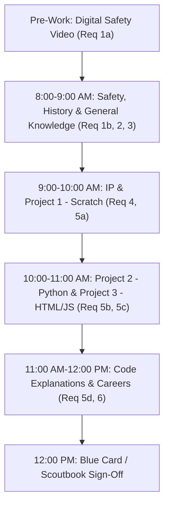

# Scouting America Programming Merit Badge: 4-Hour Workshop Master Plan

> [!IMPORTANT]
> **Key Strategy for 4-Hour Completion:**
> 1. **Zero-Install Web Environments:** Use browser-based tools (Scratch, Programiz / JDoodle, JSFiddle) to avoid installation overhead.
> 2. **Pre-Work Recommendation:** Have Scouts complete **Req 1a** (Digital Safety video/Cyber Chip) before arriving.
> 3. **Modular Hands-on Exercises:** Provide pre-built starter code for Scouts to modify, expand, debug, and explain.

---

## 📅 Workshop Schedule Breakdown (8:00 AM – 12:00 PM)



---

## ⏱️ Detailed 8:00 AM – 12:00 PM Agenda

### Hour 1: Safety, History & General Knowledge (8:00 AM – 9:00 AM)

| Time | Req # | Topic & Activity | Facilitator Notes |
| :--- | :--- | :--- | :--- |
| **8:00 – 8:15 AM** | **1b** | **Safety & Health:** First aid & prevention for programming injuries (RSI/Carpal Tunnel, eyestrain, posture). | Conduct a 2-minute "Scout Ergonomics Stretch". Discuss 20-20-20 rule for eyestrain. |
| **8:15 – 8:35 AM** | **2** | **History of Programming:** 3 major historical milestones in language evolution. | Interactive timeline: Ada Lovelace / Analytical Engine, Grace Hopper / COBOL & first bug, ENIAC, C / Unix, Web / JS, AI era. |
| **8:35 – 8:55 AM** | **3a, 3b** | **Languages & Devices:** 10 popular languages + industries; 3 daily programmed devices. | Group activity: Match programming languages to their primary domain (e.g., Python $\rightarrow$ Data Science/AI, Swift $\rightarrow$ iOS Apps, C++ $\rightarrow$ Game Engines/Robotics). |
| **8:55 – 9:00 AM** | — | **Bio / Stretch Break** | Get up, walk around, rest eyes. |

---

### Hour 2: Software Ecosystem & Project 1 (9:00 AM – 10:00 AM)

| Time | Req # | Topic & Activity | Facilitator Notes |
| :--- | :--- | :--- | :--- |
| **9:00 – 9:25 AM** | **4a, 4b, 4c** | **Intellectual Property & Licensing:**<br>• Patents vs Copyrights<br>• Licensing vs Owning<br>• Open-Source vs Proprietary | Real-world examples: Linux vs Windows, Android (open source components) vs iOS, video game EULAs vs owning physical cartridges. |
| **9:25 – 10:00 AM** | **5a** | **Project 1: Block-Based Programming (Scratch)**<br>*Industry: Interactive Gaming / Education*<br>• Open starter template.<br>• Modify logic, add a score variable/sound.<br>• Debug and test. | Platform: [scratch.mit.edu](https://scratch.mit.edu)<br>Scouts modify an existing mini-game (e.g., Catch the Flying Beetle) by adding custom speed, conditionals, or score triggers. |

---

### Hour 3: Text-Based Coding Projects (10:00 AM – 11:00 AM)

| Time | Req # | Topic & Activity | Facilitator Notes |
| :--- | :--- | :--- | :--- |
| **10:00 – 10:30 AM** | **5b** | **Project 2: Python**<br>*Industry: Data Science / Finance / Automation*<br>• Input: User prompt (numerical/text).<br>• Decision: `if/elif/else` logic.<br>• Output: Computed response/recommendation. | Platform: [programiz.com/python-programming/online-compiler](https://www.programiz.com/python-programming/online-compiler) or [jdoodle.com/python3-programming-online](https://www.jdoodle.com/python3-programming-online)<br>Project: *Weather Advisor & Gear Recommender* or *Merit Badge Savings Calculator*. |
| **10:30 – 11:00 AM** | **5c** | **Project 3: Web Development (HTML + JavaScript)**<br>*Industry: Web Applications & E-Commerce*<br>• HTML Form Input (buttons/input fields).<br>• JS Function decision making.<br>• Dynamic DOM Output on page. | Platform: [jsfiddle.net](https://jsfiddle.net) or local HTML file.<br>Project: *Interactive Scouting Ticket / Camp Cost Estimator*. |

---

### Hour 4: Code Demos, Careers & Sign-Offs (11:00 AM – 12:00 PM)

| Time | Req # | Topic & Activity | Facilitator Notes |
| :--- | :--- | :--- | :--- |
| **11:00 – 11:35 AM** | **5d** | **Scout Code Demos & Explanations:** Each Scout demonstrates their 3 projects to a counselor or peer-counselor team.<br>Explains **Inputs**, **Decisions**, and **Outputs**. | Set up 2-3 counselor stations to keep review time under 35 minutes. |
| **11:35 – 11:50 AM** | **6** | **Career Exploration:** Discuss computer science/software engineering career paths, education requirements, daily duties, and salaries. | Share personal experience or video highlight of a Day in the Life of a Software Engineer / Cybersecurity Specialist. |
| **11:50 AM – 12:00 PM** | — | **Wrap-Up & Blue Card Signing:** Collect Scoutbook updates and sign Blue Cards. | Congratulate Scouts! |

---

## 💻 Starter Code & Exercises for Requirement 5

### Project 1: Scratch (Req 5a - Gaming/Education Industry)
* **Goal:** Modify existing sprite behavior, add decision logic, debug.
* **Activity:** 
  1. Open a starter maze or catching game.
  2. **Task:** Add an `if <score > 10> then switch background to "Victory"` block and add a custom sound effect.
  3. **Debug:** Fix a built-in bug where score increments infinitely when hovering over target.

---

### Project 2: Python (Req 5b - Data Science / Automation Industry)
* **Platform:** [Programiz Online Python Compiler](https://www.programiz.com/python-programming/online-compiler) or [JDoodle Python 3](https://www.jdoodle.com/python3-programming-online)

```python
# Scouting Camp Budget & Supply Advisor
# Industry: Finance / Resource Management

print("--- Scout Trip Budget Advisor ---")

# INPUT: Collecting user inputs
scouts_count = int(input("How many Scouts are attending camp? "))
nights_count = int(input("How many nights will you stay? "))

# COMPUTATION
cost_per_scout_per_night = 15
total_cost = scouts_count * nights_count * cost_per_scout_per_night

# DECISION & COMPUTATION
if total_cost > 300:
    discount = total_cost * 0.10
    final_cost = total_cost - discount
    status = "Qualified for 10% Group Discount!"
else:
    discount = 0
    final_cost = total_cost
    status = "Standard Rate Applies."

# OUTPUT
print("\n--- Summary ---")
print(f"Total Scouts: {scouts_count}")
print(f"Total Nights: {nights_count}")
print(f"Estimated Cost: ${total_cost:.2f}")
print(f"Status: {status}")
print(f"Final Total: ${final_cost:.2f}")
```

---

### Project 3: HTML & JavaScript (Req 5c - Web Development Industry)
* **Platform:** [jsfiddle.net](https://jsfiddle.net)

```html
<!-- Index.html -->
<!DOCTYPE html>
<html>
<head>
    <title>Scout Pack Quiz</title>
</head>
<body>
    <h2>Scout Hiking Backpack Check</h2>
    <label>Enter expected outdoor temperature (&deg;F): </label>
    <input type="number" id="tempInput" placeholder="e.g. 45">
    <button onclick="checkGear()">Check Gear Requirement</button>

    <h3 id="resultOutput"></h3>

    <script>
        function checkGear() {
            // INPUT
            let temp = parseInt(document.getElementById("tempInput").value);
            let resultElement = document.getElementById("resultOutput");

            // DECISION MAKING
            if (isNaN(temp)) {
                resultElement.textContent = "Please enter a valid temperature.";
                resultElement.style.color = "red";
            } else if (temp < 50) {
                // OUTPUT 1
                resultElement.textContent = "Pack extra layers: Heavy jacket, wool hat, and thermal gloves required!";
                resultElement.style.color = "blue";
            } else {
                // OUTPUT 2
                resultElement.textContent = "Standard pack: Light jacket, sun hat, and extra water!";
                resultElement.style.color = "green";
            }
        }
    </script>
</body>
</html>
```

---

## 📚 General Knowledge Cheat Sheet for Counselors & Scouts

### 10 Popular Programming Languages & Industries (Req 3a)

| Language | Primary Industry / Use Case | Why It Is Used |
| :--- | :--- | :--- |
| **Python** | Data Science, AI, Automation, Web Backends | Simple, highly readable syntax, massive library ecosystem. |
| **JavaScript** | Web Development, Frontend & Fullstack Web Apps | Runs natively in every web browser worldwide. |
| **Java** | Enterprise Software, Android App Development | Portable ("write once, run anywhere"), high stability. |
| **C++** | Game Development, Robotics, High-Frequency Trading | Direct hardware memory control, extremely fast performance. |
| **C#** | Game Development (Unity), Enterprise Windows Software | Strong integration with Microsoft ecosystem and Unity engine. |
| **Swift** | iOS / macOS App Development | Apple's modern, safe, and fast language for Apple devices. |
| **SQL** | Database Management & Analytics | Standard language for querying relational databases. |
| **Go (Golang)** | Cloud Computing, Microservices, Infrastructure | Built by Google for concurency, speed, and simple deployment. |
| **Rust** | Systems Programming, Cybersecurity, WebAssembly | Memory safety without garbage collection performance hits. |
| **PHP** | Content Management Systems (WordPress, Drupal) | Powers majority of dynamic server-side web content. |

---

## 🛠️ Facilitator Prep Checklist

> [!TIP]
> **Before Workshop Day:**
> - [ ] Confirm room Wi-Fi capacity and power strip availability.
> - [ ] Send pre-work email to parents (Digital Safety video link).
> - [ ] Print Scout Worksheets / Cheat Sheets for non-coding sections.
> - [ ] Verify that web platforms (Scratch, Programiz/JDoodle, JSFiddle) are not blocked by facility Wi-Fi content filters.
> - [ ] Recruit 1-2 assistant counselors or older youth leaders to assist during coding sessions.
